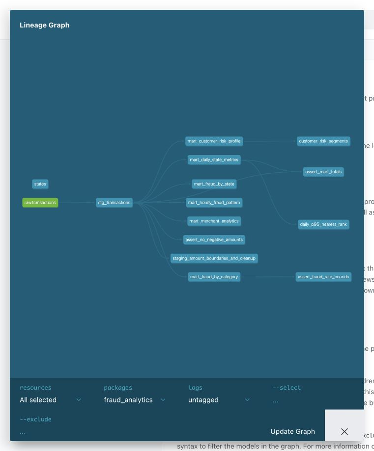

# ДЗ 4. Аналитика транзакций в dbt

## Запуск

Нужны Docker Desktop и Docker Compose. Из корня общей репы:

```bash
cd hw4
docker compose up -d --build
docker compose run --rm dbt dbt deps
docker compose run --rm -w /workspace dbt python scripts/run_checks.py
```

Если содержимое hw4 загружено в отдельную репу, команды выполняются из её корня без `cd hw4`.
`clickhouse` должен быть healthy, `loader` — завершиться с кодом 0.
Проверка строит модели, запускает тесты и SQLFluff, генерирует документацию и сохраняет логи в `reports/`.

```bash
docker compose --profile docs up -d docs
```

[dbt Docs](http://localhost:8084) — модели, колонки, тесты и граф зависимостей.
Порты 8084 и 8125 должны быть свободны. Дальнейшие команды выполняются из папки проекта.

## Данные и модели

Источник — [train.csv соревнования](https://www.kaggle.com/competitions/teta-ml-1-2025/data), тот же набор, что в ДЗ 2.
В репу включён `data/transactions.csv`: 9000 строк, по 3000 за январь–март 2020, выборка с seed=42.
Используются настоящие метки `target`, без сдвига дат. Полный train.csv исключён из Git.

Слои: `transactions_db.transactions` → `stg_transactions` → шесть витрин в схеме `analytics`.
CSV загружается в отдельный ClickHouse напрямую, поэтому запуск ДЗ 2 и Kafka не требуется.
Staging приводит типы, убирает пробелы, нормализует регистр и добавляет вычисляемые поля.

| Витрина | Содержание |
|---|---|
| mart_daily_state_metrics | По дате и штату: количество, сумма, средний чек, P95, доля крупных покупок |
| mart_fraud_by_category | По категории: число транзакций и фродов, fraud_rate, суммы |
| mart_fraud_by_state | По штату: fraud_rate, уникальные клиенты/мерчанты, суммы |
| mart_customer_risk_profile | История клиента, средний чек, fraud_rate, HIGH/MEDIUM/LOW |
| mart_hourly_fraud_pattern | Количество, сумма и fraud_rate по дню недели и часу UTC |
| mart_merchant_analytics | Оборот, fraud_rate и флаг подозрительности мерчанта |

Правила расчёта:

- Доли измеряются в процентах 0–100. P95 — nearest rank: элемент ceil(0.95 × n) отсортированного набора.
- Макрос `amount_bucket`: SMALL <100, MEDIUM от 100 до 1000, LARGE >=1000.
- Риск клиента: HIGH при fraud_rate >=5%; MEDIUM при наличии фрода с долей <5%; иначе LOW.
- Подозрительный мерчант: >=10 транзакций и fraud_rate >=1%.
- ID клиента — суррогатный ключ имени, фамилии и координат. Возможны совпадения разных людей.

## Пакеты и проверки

Версии: **dbt-core 1.10.13**, **dbt-clickhouse 1.10.3**, **SQLFluff 3.4.2**.

- dbt_utils 1.3.0 — ключ клиента и уникальность составных ключей.
- dbt_date 0.16.0 — ISO день недели 1–7.
- dbt_expectations 0.10.9 — границы fraud_rate; используемый тест проверен на ClickHouse.
- schema.yml — описания моделей/колонок, not_null, unique, accepted_values и relationships.
- Singular tests — отрицательные суммы, границы fraud_rate, совпадение числа транзакций.
- Unit tests — сегменты суммы и очистка строк, риск клиента, расчёт P95.

```bash
docker compose run --rm dbt dbt seed
docker compose run --rm dbt dbt run
docker compose run --rm dbt dbt test
docker compose run --rm dbt dbt docs generate
docker compose run --rm -w /workspace dbt sqlfluff lint dbt/models dbt/tests
```

SQLFluff сохраняет регистр функций ClickHouse. В Makefile есть команды up, deps, seed, run, test, build, lint, docs, serve, verify и down.
Полный цикл: `make up deps verify serve`.

Для Git-hook нужны Python 3.12, зависимости `requirements.txt`, dbt-пакеты и работающий ClickHouse:

```bash
python3.12 -m venv .venv
source .venv/bin/activate
pip install -r requirements.txt
pre-commit install --config .pre-commit-config.yaml
pre-commit run --config .pre-commit-config.yaml --all-files
```

В общей репе укажите из её корня `--config hw4/.pre-commit-config.yaml`.

## Проверка на полном train.csv

Поместить размеченный файл в `data/train.csv` и выполнить:

```bash
docker compose run --rm loader python scripts/load_data.py /data/train.csv --replace
docker compose run --rm -w /workspace dbt python scripts/run_checks.py
```

Неразмеченный test.csv не подходит. `--replace` заменяет raw-источник только в hw4 после успешной загрузки целого файла.
Обычный запуск loader не дублирует заполненный источник. После замены данных витрины нужно пересобрать.

## Результаты

Проверено 26 октября 2026 на **786 431 строке**, из них **4504** с фродом.
Число транзакций и фродов в витринах совпало с источником.

| Проверка | Результат |
|---|---|
| dbt build | 107 успешных узлов: 7 моделей, 1 seed, 99 тестов |
| dbt test | 96 data tests и 3 unit tests прошли, ошибок нет |
| SQLFluff | Пройден |
| pre-commit | Конфиг валиден; Git-hook отдельно не запускался |
| dbt Docs | Документация сгенерирована и открывается |

Строк в витринах: дневная — 21 386, категории — 14, штаты — 51 (включая DC), клиенты — 965, часы/дни — 168, мерчанты — 693.
На встроенном примере из 9000 строк результаты будут другими.

[Общий отчёт](reports/verification.json) · [Лог тестов](reports/dbt_test.log) · [SQLFluff](reports/sqlfluff.log) · [Версии](reports/versions.log)



## Остановка и сдача

```bash
docker compose logs --tail=100 loader clickhouse
docker compose down
```

Данные сохраняются; `docker compose down -v` удаляет том hw4.
Локальные учётные данные ClickHouse: homework / homework_local.

Для сдачи нужен PR с каталогом `dbt/`. В описание добавить версии инструментов,
перечень витрин и тестов, лог успешного dbt test и скриншот выше. Репа должна быть публичной.
